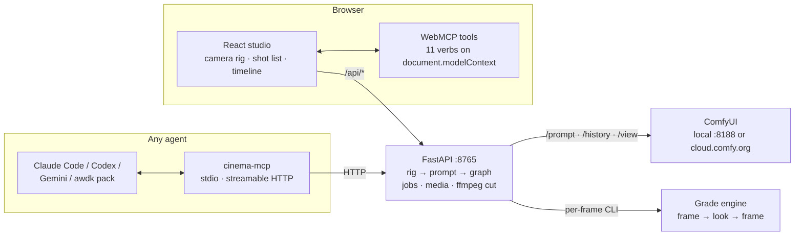
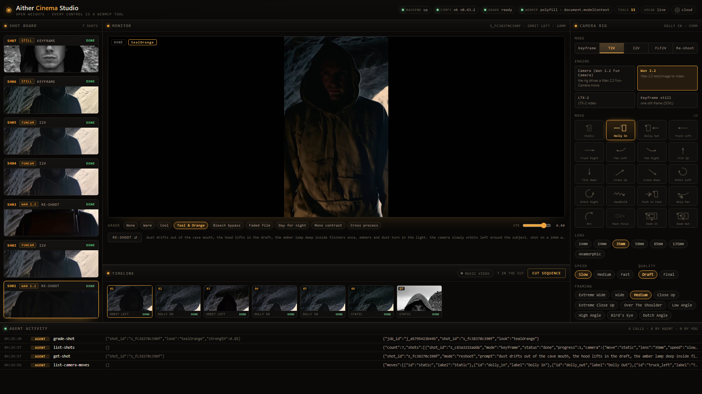
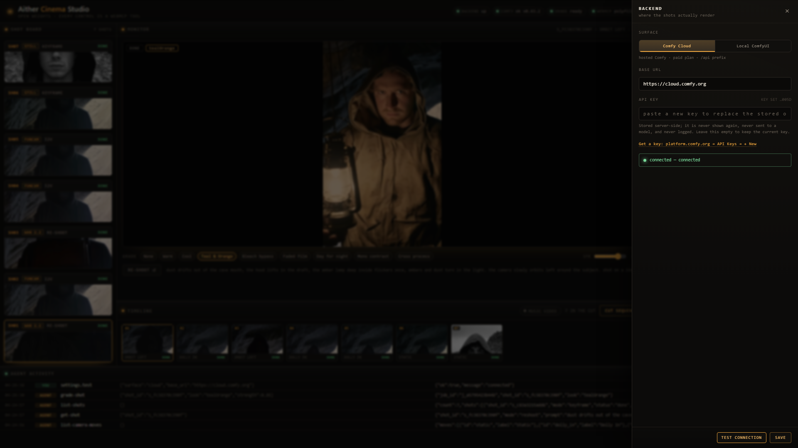
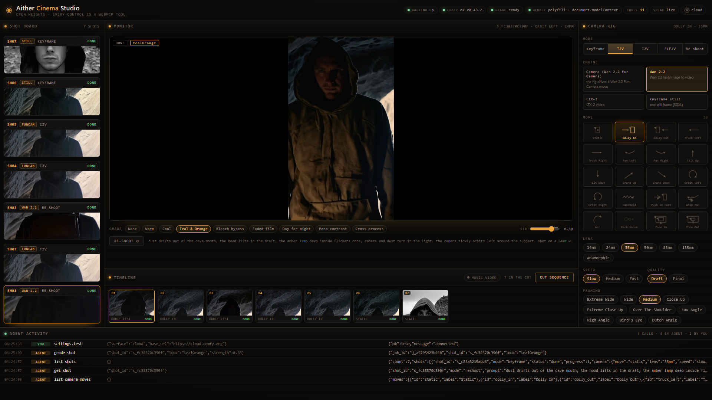
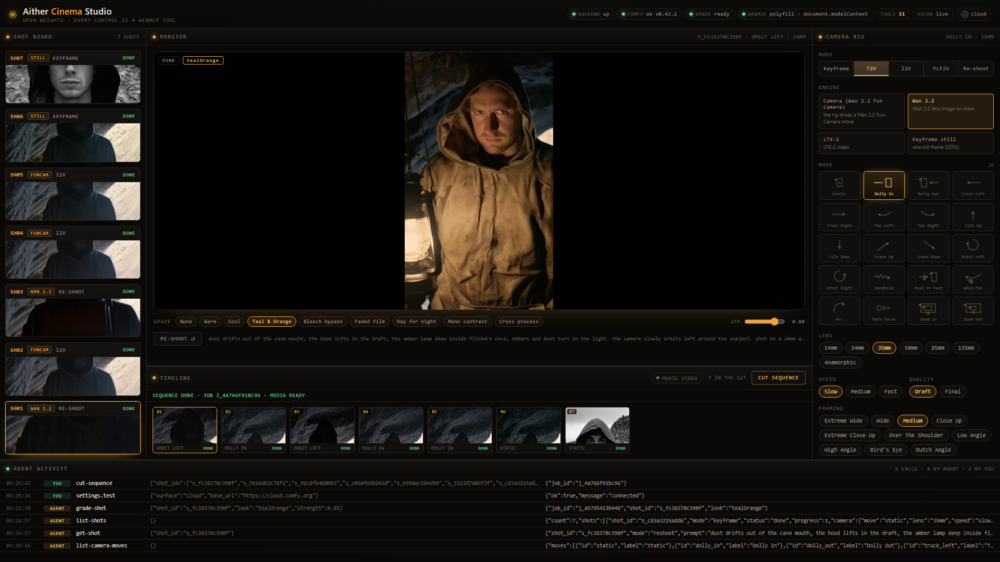

# Aither Cinema Studio

**Direct film on a ComfyUI set.** Choose a camera rig — a move, a lens, a speed, a
framing — and the studio compiles it into the prompt, renders the shot, and cuts
your sequence. Every control is a tool an agent can call — eleven WebMCP verbs in
the browser, ten MCP tools for any agent outside it.

A rig is a decision, not a slider stack. `dolly_in` + `85mm` + `close_up` is a
different shot from `static` + `85mm` + `close_up`, and the studio makes the model
honour the difference — deterministically, in the prompt text, before a GPU spends
a second on it.

## Live demo

**<https://aitherium.github.io/aither-cinema-studio/>** — the real studio, no
install, no account. It opens in **demo mode**: the camera vocabulary, a simulated
render with live progress, pre-rendered proof clips, and all eleven WebMCP tools
work in the page. Nothing leaves the tab.

The demo is `web/dist` published from the `gh-pages` branch (`npm run build` in
`web/`, then copy `dist/` plus an empty `.nojekyll`), so a static host is enough.

## Connect your backend

The demo is a static page, so it asks where to render on first load (and again in
**Settings → Connection**):

| choice | what it means |
|---|---|
| **This computer** | a studio backend at `http://127.0.0.1:8765` |
| **Remote URL** | a studio backend you host — paste its `https://` origin |
| **Demo mode** | no backend; everything is simulated in the page |

Start a backend of your own:

```bash
git clone https://github.com/Aitherium/aither-cinema-studio.git
cd aither-cinema-studio/server
python -m venv .venv
.venv/bin/pip install -e ".[dev]"        # Windows: .venv\Scripts\pip install -e ".[dev]"

export COMFY_BASE_URL=http://127.0.0.1:8188          # or COMFY_API_KEY for Comfy Cloud
export CINEMA_CORS_ORIGINS=http://localhost:5173,https://aitherium.github.io
.venv/bin/uvicorn cinema.app:app --host 127.0.0.1 --port 8765
```

`CINEMA_CORS_ORIGINS` is a comma-separated allowlist (the default already covers
`localhost:5173` and the Pages demo). The page is `https` and points at
`http://127.0.0.1`, which Chrome permits but gates behind a **Private Network
Access** preflight — the server answers it, so keep the Pages origin in the list
or the browser will refuse the connection. **Test studio connection** in the panel
probes `GET {base}/api/health` and says exactly what answered.

The choice is stored in `localStorage`; a private window simply starts fresh.

## 60-second quickstart

```bash
# 1. backend (Python 3.10+)
cd server && python -m venv .venv && .venv/Scripts/python -m pip install -e ".[dev]"
.venv/Scripts/python -m uvicorn cinema.app:app --port 8765      # bin/python on Linux/macOS

# 2. web
cd ../web && npm install && npm run dev                          # http://127.0.0.1:5173
```

Open the page, then **Settings → Comfy backend**:

- **Local ComfyUI** — leave `http://127.0.0.1:8188`. Needs a GPU and the weights
  listed in `comfy-build/README.md`.
- **Comfy Cloud** — paste your API key. The key is written `0600` to
  `server/data/settings.json`, sent as `X-API-Key` to `https://cloud.comfy.org`,
  and never logged. Cloud paths carry an `/api` prefix and `/view` answers with a
  signed redirect; the client handles both (`server/cinema/comfy.py`).

**Settings → Test connection** says whether the chain is live before you spend a
render.
The grading engine is optional: without it, every other control still works.

Then direct: pick a move, type a subject, press **Plan** (free — it shows the
compiled prompt), then **Render draft**.

## Architecture



One state, two doors. The MCP server and the WebMCP registry call the same routes
and the same zustand actions, so an agent in the browser and a human at the desk
are editing the same shot list.

### Why WebMCP

A page that registers its controls as tools is a page an agent can drive without a
screenshot loop. Here the rig is already an enum with a compiled meaning, so the
browser tool takes `{move, lens, speed, framing}` — not a sentence to guess at.
The enums come from the backend's own `camera_vocab.json`, so a tool schema cannot
drift from what the studio renders.

## Tools

| verb | what it does |
|---|---|
| `list_camera_moves` | the whole vocabulary + defaults |
| `plan_shot` | compile a rig into the exact prompt — no render |
| `render_shot` | keyframe · t2v · i2v · flf2v |
| `reshoot_shot` | lift one frame and animate it with a **new** rig |
| `grade_shot` | film look at a strength (0–1) |
| `list_shots` / `get_shot` | status, progress, `media_url` |
| `cut_sequence` | ffmpeg cut, in the order you pass |
| `cut_music_video` | beat sheet from bpm + beats/shot, then cut (and mux the track) |
| `backend_status` | backend → ComfyUI → grade chain |

Vocabulary: 20 moves, 7 lenses, 3 speeds, 10 framings, 9 looks. Modes:
`keyframe`, `t2v`, `i2v`, `flf2v`, `reshoot`; engines: `sdxl`, `wan_camera`,
`wan_t2v`, `wan_i2v`, `wan_flf2v`, `ltx` (licences per engine under
[Credits](#credits)). Full tables in [`CONTRACT.md`](CONTRACT.md).

## Use it from an agent

```bash
pip install -e "mcp/[dev]"   # the MCP server (dev extra = pytest)
cinema-mcp --check           # 0 = ready, 1 = backend down, 2 = ComfyUI down

cp -r skills/aither-cinema ~/.claude/skills/      # Claude Code skill
```

| client | drop-in |
|---|---|
| Claude Code | [`agents/claude-code/.mcp.json`](agents/claude-code/.mcp.json) |
| Codex CLI | [`agents/codex/config.toml`](agents/codex/config.toml) |
| Gemini CLI | [`agents/gemini/settings.json`](agents/gemini/settings.json) |
| awdk / AitherOS | [`agents/awdk/aither-cinema/`](agents/awdk/aither-cinema/) |

The pack is validated against the real `adk.agent_pack` loader; details and the
measured argv are in [`agents/README.md`](agents/README.md).


## Run it with Aitherium

Aither Cinema Studio is the open, self-hostable studio. To give it a permanent agent, memory and a
control plane, run it under **[awdk](https://github.com/Aitherium/awdk)**, the Aitherium agent toolkit.
Your models, renders and data stay on your machine; Aitherium hosts only the control plane.

```bash
pip install awdk                                    # or: curl -fsSL https://aitherium.com/install.sh | sh
# Windows: powershell -ExecutionPolicy ByPass -c "irm https://aitherium.com/install.ps1 | iex"
```

Then load the agent pack in [`agents/awdk/aither-cinema/`](agents/awdk/aither-cinema/) so your awdk agent
directs shots through `cinema-mcp`. Docs: [aitherium.github.io/awdk](https://aitherium.github.io/awdk/) ·
[aitherium.com](https://aitherium.com).

## Run it on Comfy Cloud hardware

[`comfy-build/`](comfy-build/) holds a `comfy build` spec (base ComfyUI
`v0.43.2`, the Wan 2.2 + RealVisXL weights with pinned `sha256`) that has passed
`comfy build validate` both offline and `--remote`, and `comfy build push
--dry-run` with zero uploads. Nothing was pushed or released.

## Proof

Five renders made through the real backend path (`python -m cinema.cli render`)
against Comfy Cloud on 2026-10-30 — one keyframe, `wan_camera` 480x832/49 frames,
`wan_i2v`, `wan_t2v`, and an `ltx` draft — sit in [`docs/proof/`](docs/proof/) with
their commands, exit codes, seconds, dimensions and the backend's own shot records
([`proof.json`](docs/proof/proof.json)). Proving them live is what found the
two-expert latent handoff bug and the clip-vision encode mismatch.

## Screenshots

The studio driving Comfy Cloud end to end on 2026-10-30: an agent plans and renders a
shot over WebMCP while the human watches, reshoots it to a new angle, grades it, and
cuts the timeline. Full-size PNGs in [`docs/screenshots/`](docs/screenshots/).

| Studio | Backend |
|---|---|
|  |  |
| **01 · Studio overview** — shot board, monitor playing the graded clip, camera rig, timeline, and the agent activity feed where every row is one WebMCP call. | **02 · Backend** — the key is stored server-side and shown only as a hint; Test connection is green against `cloud.comfy.org`. |

| Agent activity | Timeline cut |
|---|---|
|  |  |
| **03 · Agent activity** — agent calls (`list-camera-moves`, `get-shot`, `list-shots`, `grade-shot`) and the human's `settings.test` in one feed. | **04 · Timeline cut** — 7 shots in the cut, sequence job done, media ready. |

## Repository

```
server/      FastAPI: rig → prompt → Comfy graph, jobs, media, ffmpeg cut
web/         React studio + WebMCP tool registry
mcp/         cinema-mcp: the ten tools over stdio / streamable HTTP
skills/      aither-cinema: the Claude Code skill (vocabulary + recipes)
agents/      client adapters + awdk agent pack
comfy-build/ Comfy API Build spec for cloud renders
workflows/   the four API-format graphs (keyframe, t2v, i2v, flf2v)
comfy_nodes/ ComfyUI-CinemaRig — two nodes for directing inside ComfyUI
demo/        "madness." — a written treatment and its beat grid
docs/        Comfy probe + cloud research (measured, sourced)
```

Tests: `cd server && .venv/Scripts/python -m pytest -q` ·
`cd mcp && python -m pytest -q` · `cd web && npm test`.

## Credits

Per-engine licence table — the weights are downloaded by you, never shipped here:

| engine | what it makes | weights it loads | licence |
|---|---|---|---|
| `sdxl` | keyframe still | `realvisxlV50_v50Bakedvae.safetensors` (cloud) / `RealVisXL_V4.0.safetensors` (local) | CreativeML OpenRAIL++-M — open weights with use restrictions, not OSI |
| `wan_camera` | camera move from a start frame | Wan 2.2 Fun Camera 14B high/low noise + lightx2v 4-step i2v LoRAs | Apache-2.0 |
| `wan_t2v` | text → video | Wan 2.2 T2V-A14B high/low noise + lightx2v v1.1 4-step LoRAs | Apache-2.0 |
| `wan_i2v` | image → video | Wan 2.2 I2V-A14B high/low noise + lightx2v 4-step LoRAs | Apache-2.0 |
| `wan_flf2v` | first/last frame → video | Wan 2.2 FLF2V (I2V-A14B experts) | Apache-2.0 |
| `ltx` | text → video with an audio-video latent | `ltx-2-19b-distilled-fp8` + `gemma_3_12B_it_fp8_scaled` | LTX-2 Community License Agreement — custom terms, not OSI |

- **Engine:** film-grade looks are produced by invoking the **PhotoCraft**
  CLI (`photocraft-cli`, MIT OR Apache-2.0, ArtCraft Team) as an external
  process. No PhotoCraft code is included; the name appears here and in
  [`NOTICE`](NOTICE) only.
- **Video:** [Wan 2.2](https://github.com/Wan-Video/Wan2.2) (Apache-2.0) for
  t2v / i2v / flf2v; [LTX-2](https://huggingface.co/Lightricks/LTX-2)
  (Lightricks, open weights under the LTX-2 Community License — read the model
  card for redistribution terms) backs the `ltx` engine. The newer LTX 2.3 line
  ([LTX-2.3-fp8](https://huggingface.co/Lightricks/LTX-2.3-fp8)) is a commented
  candidate in the build spec; no shipped graph loads it.
- **Stills:** RealVisXL V4.0 (CreativeML OpenRAIL++-M — not an OSI licence; the
  weights are downloaded by you, not shipped here).
- **Runtime:** [ComfyUI](https://github.com/comfyanonymous/ComfyUI) (GPL-3.0),
  invoked over HTTP as a separate process; ffmpeg (GPL/LGPL build, spawned as a
  binary).
- See [`NOTICE`](NOTICE) for the full licence table, primary sources and the
  components marked unverified.

## Licence

MIT — see [`LICENSE`](LICENSE). Model weights and ComfyUI keep their own licences
(above); this repository ships none of them.
